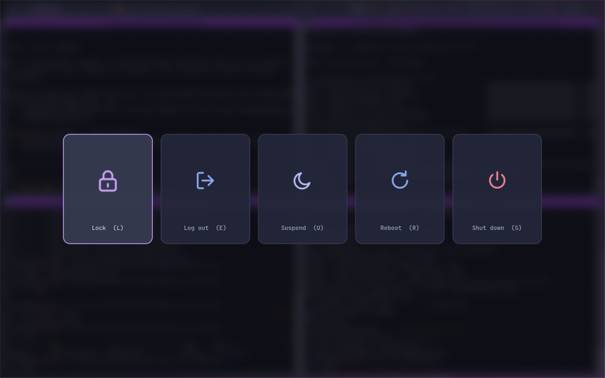

# HyprArch - Dotfiles


Dotfiles and installer for a clean, keyboard-driven **Hyprland** desktop on **Arch Linux**, built for laptops.
Every component shares the same Catppuccin Macchiato palette with blue and mauve accents, and the whole setup
can be installed with a single script.

<p align="center">
  
</p>

---

## Table of contents

- [Features](#features)
- [Components](#components)
- [Repository layout](#repository-layout)
- [Installation](#installation)
- [Key bindings](#key-bindings)
- [Status bar](#status-bar)
- [Idle and lock behaviour](#idle-and-lock-behaviour)
- [Customization](#customization)
- [Troubleshooting](#troubleshooting)
- [Updating](#updating)
- [Credits](#credits)

---

## Features

- **Modular Hyprland configuration**: one file per topic (monitors, environment, autostart, input, look, rules, bindings), using the Hyprland 0.54 syntax.
- **Informative but minimal status bar** (Waybar): workspaces with the icons of their windows, active window title, media player, background applications, pending updates, CPU / RAM / temperature / disk, network and Bluetooth, keyboard layout, audio and microphone, brightness, power profile and battery.
- **Background-app indicators**: Discord, Spotify and Obsidian appear in the bar while they run, even with no open window; one click focuses or reopens them.
- **Automatic screen locking** after 5 minutes (hypridle + hyprlock), with no automatic suspend.
- **Custom power menu** (wlogout) with themed SVG icons and single-key shortcuts.
- **Laptop friendly**: tap-to-click, three-finger workspace swipe, variable refresh rate, lighter blur, power profiles, low-battery notifications through a systemd timer.
- **US + FR keyboard layouts**, switched with `Alt+Shift`; workspace bindings use physical key codes, so they work with both QWERTY and AZERTY.
- **Clipboard history** (cliphist) on `Super+C`.
- **Native Wayland** for Qt, Electron (Discord, VS Code, Obsidian…), Firefox and Java applications; correct sizing for XWayland apps at 125 % scaling.
- **Consistent theme** across Hyprland borders, Waybar, kitty, wofi, mako, hyprlock, wlogout, GTK (dark), Papirus icons and Catppuccin cursors.
- **Safe installer**: existing configuration files are backed up before being replaced.

## Components

| Role | Software |
|---|---|
| Compositor | [Hyprland](https://hyprland.org) |
| Status bar | [Waybar](https://github.com/Alexays/Waybar) |
| Lock screen / idle daemon | [hyprlock](https://github.com/hyprwm/hyprlock) / [hypridle](https://github.com/hyprwm/hypridle) |
| Power menu | [wlogout](https://github.com/ArtsyMacaw/wlogout) |
| Application launcher | [wofi](https://hg.sr.ht/~scoopta/wofi) |
| Notifications | [mako](https://github.com/emersion/mako) |
| Terminals | [kitty](https://sw.kovidgoyal.net/kitty/) (default), Terminator |
| File manager | Thunar |
| Wallpaper | swaybg |
| Screenshots | grim + slurp + swappy |
| Clipboard | wl-clipboard + cliphist |
| Audio | PipeWire + WirePlumber, pavucontrol, playerctl |
| Network / Bluetooth | NetworkManager (`nmtui`), BlueZ + Blueberry |
| Power | power-profiles-daemon, brightnessctl |
| Shell / editor | zsh + oh-my-zsh + zsh-autosuggestions, vim |
| Fonts and themes | JetBrainsMono Nerd Font, Catppuccin Macchiato, Papirus-Dark, Catppuccin cursors |

## Repository layout

```text
my_arch/
├── install_arch_hyprland.sh        # installer
├── config/                         # copied to ~/.config/
│   ├── hypr/
│   │   ├── hyprland.conf           # entry point, sources conf/*.conf
│   │   ├── conf/
│   │   │   ├── monitors.conf       # resolution, scaling, XWayland
│   │   │   ├── env.conf            # Wayland / toolkit / cursor variables
│   │   │   ├── autostart.conf      # programs started with the session
│   │   │   ├── input.conf          # keyboard layouts, touchpad, gestures
│   │   │   ├── looks.conf          # gaps, borders, blur, shadows, animations
│   │   │   ├── rules.conf          # window and layer rules
│   │   │   └── binds.conf          # key bindings
│   │   ├── hypridle.conf           # dim / lock / screen-off timings
│   │   ├── hyprlock.conf           # lock screen
│   │   ├── scripts/battery-notify.sh
│   │   ├── xdg-portal-hyprland     # portal start-up helper
│   │   └── *.jpg                   # wallpapers
│   ├── waybar/Waybar-3.0/
│   │   ├── config                  # modules (JSON)
│   │   ├── style.css
│   │   └── scripts/                # updates.sh, app-status.sh, app-focus.sh
│   ├── wlogout/                    # layout, style.css, icons/*.svg
│   ├── kitty/                      # kitty.conf, macchiato.conf
│   ├── mako/  wofi/  swappy/  terminator/  gtk-3.0/
│   └── systemd/user/               # battery-notify.service / .timer
├── zsh/zshrc                       # copied to ~/.zshrc
├── vim/vimrc                       # copied to ~/.vimrc
└── docs/screenshots/
```

## Installation

### Requirements

- An up-to-date **Arch Linux** installation with a regular user that can use `sudo`.
- An internet connection.
- [`yay`](https://github.com/Jguer/yay) for the AUR packages (`wlogout`, `blueberry`, `catppuccin-cursors-macchiato`). The installer offers to install it if it is missing.

### Quick install

```bash
bash <(curl -fsSL https://raw.githubusercontent.com/STERN3L/my_arch/main/install_arch_hyprland.sh)
```

When run this way, the script clones the repository to a temporary directory and continues from there, so the configuration files are installed as well.

### Manual install

```bash
git clone https://github.com/STERN3L/my_arch.git
cd my_arch
./install_arch_hyprland.sh            # interactive
./install_arch_hyprland.sh --yes      # answer "yes" to every prompt
```

### What the installer does

Each step is optional and asked interactively (unless `--yes` is used):

1. Updates the system and installs the official and AUR packages.
2. Enables `NetworkManager`, `bluetooth` and `power-profiles-daemon`.
3. Copies `config/*` to `~/.config/`, makes the scripts executable, enables the `battery-notify.timer` user unit and applies the GTK dark theme, icons and cursor through `gsettings`.
4. Optionally installs oh-my-zsh, the `zsh-autosuggestions` plugin and `~/.zshrc`, and can make zsh the default shell.
5. Optionally installs `~/.vimrc`.
6. Optionally installs `sof-firmware` (audio on most recent laptops).

> [!NOTE]
> Any existing file or directory that would be replaced is first moved to `~/.config-backup-<timestamp>/`.
> To roll back, copy it back to its original location.

### After installing

Log out, then start Hyprland (type `Hyprland` from a TTY, or select it in your display manager). Environment variables, idle management and the clipboard history are only active in a new session.

## Key bindings

`Super` is the Windows key.

| Keys | Action |
|---|---|
| `Super + Enter` | Open kitty |
| `Super + Shift + Enter` | Open Terminator |
| `Super + D` | Application launcher (wofi) |
| `Super + E` | File manager (Thunar) |
| `Super + C` | Clipboard history |
| `Super + Shift + S` | Screenshot of a region, opened in swappy |
| `Super + L` | Lock the screen |
| `Super + M` | Power menu |
| `Super + Shift + M` | Quit Hyprland |
| `Super + Shift + Q` | Close the active window |
| `Super + F` | Toggle fullscreen |
| `Super + V` | Toggle floating |
| `Super + P` / `Super + J` | Pseudo-tile / toggle split direction (dwindle) |
| `Super + R` | Resize mode: arrow keys (`Shift` for fine steps), `Esc` or `Enter` to leave |
| `Super + ←↑→↓` | Move focus |
| `Super + Shift + ←↑→↓` | Move the active window |
| `Super + 1…0` | Go to workspace 1–10 |
| `Super + Shift + 1…0` | Move the active window to workspace 1–10 |
| `Super + scroll` | Next / previous workspace |
| `Super + left / right drag` | Move / resize a window |
| `Alt + Shift` | Switch keyboard layout (US ⇄ FR) |
| Three-finger swipe | Switch workspace |
| Media keys | Volume, microphone mute, brightness, play / pause / next / previous |

**Power menu** (`Super + M`): `L` lock · `E` log out · `U` suspend · `R` reboot · `S` shut down · `Esc` close.

## Status bar

From left to right:

| Module | Shows | Interactions |
|---|---|---|
| Arch logo | — | Click: launcher · Right-click: terminal |
| Workspaces | Workspaces 1–5 (always visible) with the icons of their windows | Click: switch · Scroll: next / previous |
| Window | Icon and title of the focused window | — |
| Clock | Time; calendar in the tooltip | Click: full date · Right-click: month / year view · Scroll: change month |
| Media | Current track (MPRIS) | Click: play / pause · Middle: previous · Right: next |
| Privacy | Screen sharing or microphone in use | — |
| Background apps | Discord, Spotify, Obsidian while running (bright: window open, dimmed: background only) and the system tray | Click: focus or reopen |
| Updates | Number of pending updates (official repositories + AUR) | Click: run `yay` · Right-click: refresh |
| System | CPU, RAM, CPU temperature, disk usage | Click CPU: `htop` · Click RAM: used / total · Click disk: Filelight |
| Connectivity | Wi-Fi network (or Ethernet), Bluetooth | Click Wi-Fi: `nmtui` · Right-click: bandwidth · Click Bluetooth: Blueberry · Right-click: power on / off |
| Controls | Keyboard layout, volume and microphone, brightness | Click layout: switch · Click volume: mute · Middle: mute microphone · Right: pavucontrol · Scroll: volume / brightness |
| Energy | Power profile, battery | Click profile: cycle power-saver / balanced / performance · Click battery: time remaining |
| Power | — | Click: power menu · Right-click: lock |

Colours carry meaning: blue and mauve are used for normal values, **peach** for warnings (high usage, low battery, more than 50 updates), **red** for critical states and **green** while charging or in power-saver mode.

## Idle and lock behaviour

Managed by `hypridle` (`config/hypr/hypridle.conf`):

| Idle time | Action |
|---|---|
| 4 min 30 s | Screen dimmed to 10 % |
| 5 min | Screen locked (hyprlock) |
| 6 min | Display turned off (the computer keeps running) |

There is no automatic suspend. Media playback and calls inhibit idle. The session is also locked before the system goes to sleep, for example when the lid is closed.

Low-battery notifications are sent at 20 % and 10 % by `battery-notify.timer`.

## Customization

| To change… | Edit |
|---|---|
| Resolution, scaling, extra monitors | `hypr/conf/monitors.conf` |
| Wallpaper | `hypr/conf/autostart.conf` (`swaybg`) and `hypr/hyprlock.conf` (`background`) |
| Keyboard layouts / toggle shortcut | `kb_layout` and `kb_options` in `hypr/conf/input.conf` |
| Gaps, borders, blur, animations | `hypr/conf/looks.conf` |
| Applications pinned to a workspace, floating windows | `hypr/conf/rules.conf` |
| Lock and screen-off delays | `hypr/hypridle.conf` |
| Bar modules and their order | `waybar/Waybar-3.0/config` |
| Bar colours | `@define-color` variables at the top of `waybar/Waybar-3.0/style.css` |

**Adding a background application to the bar**: duplicate one of the `custom/app-*` blocks in `waybar/Waybar-3.0/config`, set the process name, window class, display name, Nerd Font icon and launch command, then add the new module to `group/apps`. The Obsidian module expects the AppImage at `~/Tools/Obsidian-<version>.AppImage`; adjust its `on-click` command to match your installation.

Hyprland reloads its configuration automatically when a file is saved. Waybar reloads its style automatically; after editing the module configuration, restart it with `pkill waybar; waybar -c ~/.config/waybar/Waybar-3.0/config -s ~/.config/waybar/Waybar-3.0/style.css & disown`.

## Troubleshooting

| Symptom | Solution |
|---|---|
| Hyprland shows a red error banner | Run `hyprctl configerrors` to see the faulty line. |
| The updates module shows `?` | Install `pacman-contrib` (provides `checkupdates`). |
| The power-profile module is empty | `sudo systemctl enable --now power-profiles-daemon` |
| The screen never locks automatically | Check that `hypridle` is running (`pgrep hypridle`); it starts with the session. |
| `Super + C` does nothing | Install `cliphist` and log in again (the clipboard watcher starts with the session). |
| An application has no tray icon | Some Electron applications need `libappindicator-gtk3`; restart the application after starting Waybar. |
| XWayland applications look too small | Check that `xorg-xrdb` is installed: the session sets `Xft.dpi` to match the 1.25 scale. |
| A new window opens maximized | Make sure `remember_window_size no` is set in `kitty.conf`; the `suppress_event maximize` rule handles other applications. |

## Updating

```bash
cd my_arch
git pull
./install_arch_hyprland.sh
```

Existing files are backed up again before being replaced, so local changes are never lost.

## Credits

- [Catppuccin](https://github.com/catppuccin) for the colour palette, the kitty theme and the cursors.
- [Papirus](https://github.com/PapirusDevelopmentTeam/papirus-icon-theme) for the icon theme.
- [Nerd Fonts](https://www.nerdfonts.com) for the JetBrainsMono patched font and its icons.
- The [Hyprland wiki](https://wiki.hyprland.org) and the [Waybar wiki](https://github.com/Alexays/Waybar/wiki).
